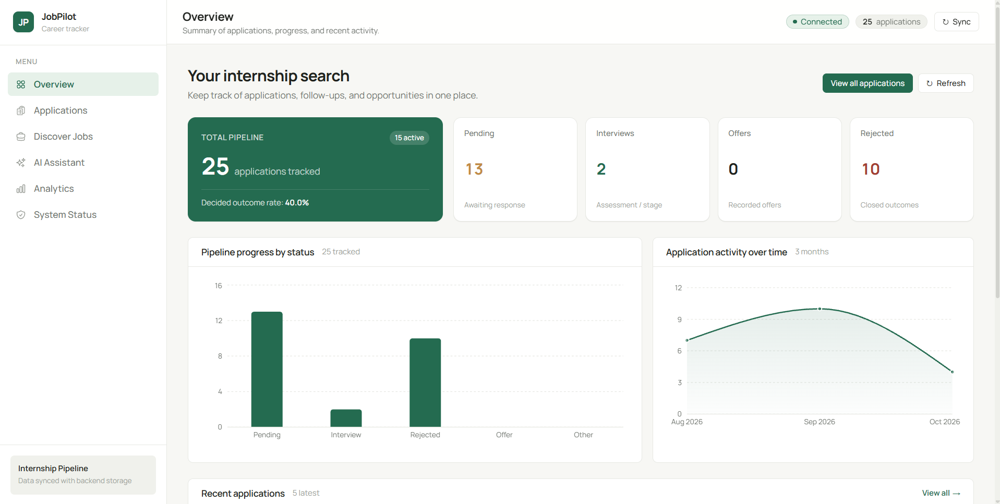
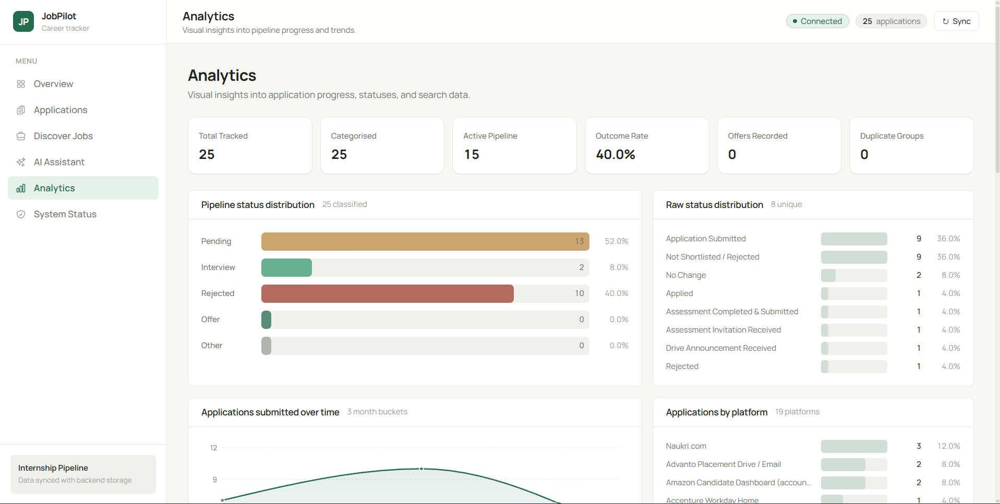
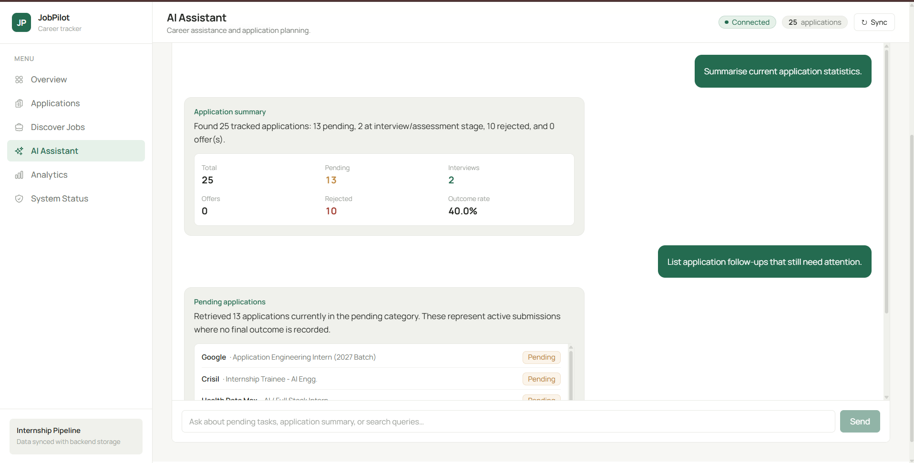
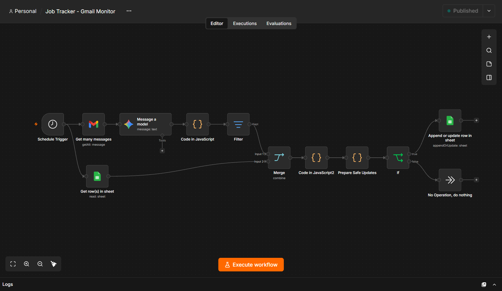
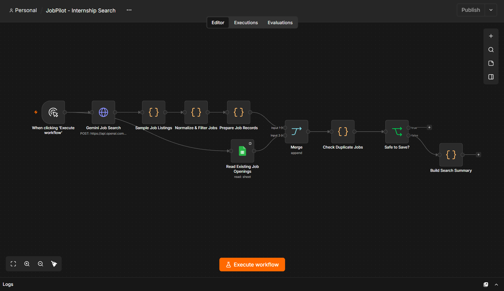

# JobPilot — Internship Search and Application Tracker

JobPilot is a personal internship search and application tracking platform built by a final-year Computer Science student. It is designed to help track internship applications, review application progress with visual analytics, discover relevant opportunities, and explore automation using n8n and Google Sheets.

---

## Table of Contents

- [About the Project](#about-the-project)
- [Features](#features)
- [Screenshots](#screenshots)
- [Technology Stack](#technology-stack)
- [Project Structure](#project-structure)
- [Requirements](#requirements)
- [Setup Instructions](#setup-instructions)
  - [Backend Setup](#backend-setup)
  - [Frontend Setup](#frontend-setup)
- [Google Sheets Configuration](#google-sheets-configuration)
- [n8n Automation Setup](#n8n-automation-setup)
- [API Endpoints](#api-endpoints)
- [Limitations](#limitations)
- [Future Improvements](#future-improvements)
- [License](#license)
- [Author](#author)

---

## About the Project

Searching and applying for internships across multiple job portals can quickly become chaotic. JobPilot was created as a central hub to:

1. **Track Applications:** Monitor application statuses (submitted, assessment, interview, rejected, offer) and platforms in one place.
2. **Gain Insights:** Visualize outcome rates, monthly submission trends, and status breakdowns through clean analytics.
3. **Discover Opportunities:** Review internship openings filtered by skills, location, work arrangement, and heuristic match scores.
4. **Explore Workflow Automation:** Leverage n8n workflows for automated inbox monitoring and opportunity scraping.

---

## Features

### 1. Overview Dashboard
- High-level metric summary: Total applications, active pipeline, pending items, interviews, offers, and rejections.
- Interactive status category breakdown and monthly submission trend charts.
- Recent applications feed with quick navigation to full records.
- Live backend connection badge and data freshness indicator.

### 2. Application Tracker
- Tabular display of all tracked applications with company, role, status, applied date, latest update date, application type, platform, and job ID.
- Search and filtering by company/role, status category or raw status string, and platform.
- Client-side sorting on loaded rows with server-side pagination.
- Semantic status chips distinguishing pending work, active interviews, offers, and rejections.

### 3. Discover Internships
- Opportunity explorer supporting filters for location, verification status, skills, work arrangement, and minimum match score.
- Dedicated empty states that handle unpopulated sheets honestly without generating placeholder or fake listings.
- Explanation of the transparent preference-matching model and market skill demand.

### 4. Career Assistant
- Conversational command deck offering four practical actions:
  - *Review job-related emails* (workflow-backed prototype)
  - *Find new internships* (workflow-backed prototype)
  - *Review pending applications* (live query against active records)
  - *Summarize application progress* (live calculation from analytics endpoint)
- Honest reporting of capability execution without fabricated AI responses.

### 5. Analytics
- Pipeline funnel breakdown displaying mutually exclusive status distributions.
- Volume comparison chart across application platforms.
- Data completeness audit reporting empty spreadsheet fields and duplicate groups.

### 6. System Status
- Operational diagnostic overview displaying backend version, data source type, row counts, and cache state.
- Complete read-only API endpoint inventory.
- Feature capability verification matrix documenting live vs. planned integrations.

---

## Screenshots

### Overview Dashboard


### Analytics Dashboard


### Career Assistant


### n8n Automation Workflows
| Gmail Monitor Workflow | Search Workflow |
|---|---|
|  |  |

---

## Technology Stack

- **Frontend:**
  - React 19
  - TypeScript
  - Vite
  - Tailwind CSS v4
  - Recharts
  - Axios
  - `@fontsource/manrope`
- **Backend:**
  - Python 3.10+
  - FastAPI
  - Pandas
  - Uvicorn
  - Pydantic v2
  - Gspread (Google Sheets API client)
- **Data Storage:**
  - Google Sheets (`Applications` and `Job Openings` worksheets)
  - Local CSV fallback
- **Automation:**
  - n8n (running locally via Docker)

---

## Project Structure

```
JobPilot/
├── backend/                  # FastAPI backend service
│   ├── app/
│   │   ├── analytics.py      # Pipeline metrics, status rules, deduplication, scoring
│   │   ├── config.py         # Pydantic Settings and environment variable validation
│   │   ├── main.py           # FastAPI application, route handlers, and CORS setup
│   │   ├── schemas.py        # Pydantic request/response models
│   │   └── sheets.py         # Google Sheets (gspread) and CSV data source loaders
│   ├── tests/                # Pytest test suite covering analytics, API, and matching
│   ├── .env.example          # Template environment file with safe placeholders
│   ├── .gitignore            # Backend-specific ignore rules
│   ├── pyproject.toml        # Ruff and pytest configuration
│   └── requirements.txt      # Python dependencies
│
├── frontend/                 # React + TypeScript frontend application
│   ├── src/
│   │   ├── api/              # Axios HTTP client, typed endpoints, and schema definitions
│   │   ├── components/
│   │   │   ├── charts/       # Recharts wrappers (bar, horizontal bar, area trend)
│   │   │   ├── domain/       # StatusCell and domain-specific components
│   │   │   ├── layout/       # AppShell, Header, SideNav, ConnectionBadge
│   │   │   └── ui/           # Button, Panel, DataTable, Field, Chip, Pagination, states
│   │   ├── hooks/            # useApi, useClock, useDebouncedValue
│   │   ├── lib/              # Formatting helpers, capability matrix, status styling
│   │   ├── pages/            # Overview, Tracker, Jobs, Assistant, Analytics, Status
│   │   └── system/           # SystemContext for polling health and metadata
│   ├── .env.example          # Frontend configuration template
│   ├── .gitignore            # Frontend-specific ignore rules
│   ├── package.json          # Node scripts and dependencies
│   ├── tsconfig.json         # Strict TypeScript compiler configuration
│   └── vite.config.ts        # Vite configuration with /api proxy to backend
│
├── docs/
│   └── images/               # Project screenshots and workflow diagrams
│
├── .gitignore                # Root repository ignore rules
└── README.md                 # Project documentation
```

---

## Requirements

- **Python:** 3.10 or newer
- **Node.js:** 18 or newer (with npm)
- **Docker:** Optional, required only for running local n8n automation workflows
- **Google Cloud Service Account:** Optional, required only for live Google Sheets synchronization

---

## Setup Instructions

### Backend Setup

1. Open a terminal and navigate to the `backend/` directory:
   ```bash
   cd backend
   ```

2. Create and activate a Python virtual environment:
   - **PowerShell (Windows):**
     ```powershell
     python -m venv .venv
     .\.venv\Scripts\Activate.ps1
     ```
   - **Command Prompt (Windows):**
     ```cmd
     python -m venv .venv
     .\.venv\Scripts\activate.bat
     ```
   - **macOS / Linux:**
     ```bash
     python3 -m venv .venv
     source .venv/bin/activate
     ```

3. Install required dependencies:
   ```bash
   python -m pip install --upgrade pip
   python -m pip install -r requirements.txt
   ```

4. Configure environment variables:
   ```bash
   cp .env.example .env
   ```
   *Note:* By default, running without `.env` or with `DATA_SOURCE=csv` will use the local CSV files in `backend/data/`. If using Google Sheets, see [Google Sheets Configuration](#google-sheets-configuration).

5. Start the backend server:
   ```bash
   python -m uvicorn app.main:app --reload --port 8000
   ```
   The backend will be available at `http://127.0.0.1:8000`. Interactive API documentation (Swagger UI) is accessible at `http://127.0.0.1:8000/docs`.

6. *(Optional)* Run backend automated tests:
   ```bash
   python -m pytest
   ```

---

### Frontend Setup

1. Open a second terminal and navigate to the `frontend/` directory:
   ```bash
   cd frontend
   ```

2. Install dependencies:
   ```bash
   npm install
   ```

3. Start the development server:
   ```bash
   npm run dev
   ```
   The application will be accessible at `http://localhost:3000`. The Vite development server automatically proxies requests starting with `/api` to `http://127.0.0.1:8000`.

4. Build for production:
   ```bash
   npm run build
   ```
   This runs the strict TypeScript type check (`tsc --noEmit`) and compiles optimized static assets into `dist/`.

---

## Google Sheets Configuration

JobPilot can read live application and job opening data directly from Google Sheets using a read-only service account.

1. **Create Service Account in Google Cloud:**
   - Go to the [Google Cloud Console](https://console.cloud.google.com/) and create a project.
   - Enable the **Google Sheets API** under *APIs & Services > Library*.
   - Create a Service Account under *APIs & Services > Credentials*.
   - Generate and download a JSON key. Save it locally (e.g., `backend/secrets/credentials.json`). **Never commit this file.**

2. **Share the Spreadsheet:**
   - Open your Google Sheet.
   - Click **Share** and add your service account's email address as a **Viewer** (read-only access is sufficient).

3. **Configure `backend/.env`:**
   ```dotenv
   DATA_SOURCE=google_sheets
   GOOGLE_SHEETS_SPREADSHEET_ID=your_spreadsheet_id_here
   GOOGLE_APPLICATION_CREDENTIALS=secrets/credentials.json
   GOOGLE_SHEETS_APPLICATIONS_TAB=Sheet1
   GOOGLE_SHEETS_JOBS_TAB=Sheet2
   SHEETS_CACHE_TTL_SECONDS=300
   ```

---

## n8n Automation Setup

JobPilot utilizes n8n for background automation workflows:

1. **Gmail Monitoring Workflow:**
   - Connects to Gmail via OAuth2.
   - Periodically scans for interview invitations, assessment links, and status updates.
   - Extracts company names and updates the corresponding rows in the Google Sheet.

2. **Internship Search Workflow:**
   - Queries configured job boards and APIs based on target roles (e.g., Software Engineering, AI/ML, Backend).
   - Formats openings with stipend, duration, and required skills, then appends them to the `Job Openings` tab.

To run n8n locally with Docker:
```bash
docker run -d --name n8n -p 5678:5678 -v n8n_data:/home/node/.n8n docker.n8n.io/n8nio/n8n
```
Once started, access the n8n editor at `http://localhost:5678`.

---

## API Endpoints

All backend endpoints are read-only (`GET`) and return JSON responses.

| Method | Endpoint | Query Parameters | Description |
|---|---|---|---|
| `GET` | `/api/health` | None | Service status, active data source, and row counts |
| `GET` | `/api/dashboard` | None | Consolidated payload for the main dashboard view |
| `GET` | `/api/applications` | `status`, `platform`, `company`, `page`, `page_size` | Paginated list of tracked applications with filters |
| `GET` | `/api/jobs` | `location`, `skill`, `verification`, `work_arrangement`, `min_match_score`, `page`, `page_size` | Paginated list of job openings with filters |
| `GET` | `/api/analytics/applications` | None | Application status counts, categories, and monthly trends |
| `GET` | `/api/analytics/jobs` | None | Aggregated job listing metrics by location and company |
| `GET` | `/api/analytics/skills` | `limit`, `min_count` | Ranking of requested skills across job listings |
| `GET` | `/api/analytics/matching` | `limit`, `min_score`, `include_unmatched` | Explainable keyword match scoring against preferences |
| `GET` | `/api/meta` | None | Application configuration and target keyword interests |

---

## Limitations

- **Read-Only Backend:** The FastAPI backend does not write or mutate Google Sheets data directly. Changes to application records occur either manually in the spreadsheet or via n8n automation workflows.
- **Empty Job Listings:** The `Job Openings` sheet currently contains zero rows. The interface displays designed empty states rather than fabricating synthetic jobs.
- **Client-Side Sorting:** Table sorting in the application tracker operates on the current page of loaded data, while filtering and pagination are executed server-side.
- **Heuristic Matching:** Opportunity scoring is based on transparent keyword overlap rules rather than complex machine learning models.

---

## Future Improvements

- Add direct webhook triggers between the frontend and local n8n workflows for on-demand inbox scans.
- Implement reminder notifications for upcoming application deadlines and interview dates.
- Add support for custom notes and preparation checklists directly linked to application records.
- Introduce CSV export functionality directly from the frontend tracker table.

---

## License

No license has been specified yet.

---

## Author

Built by a final-year Computer Science student as a personal learning project exploring full-stack development, API integration, and workflow automation.
